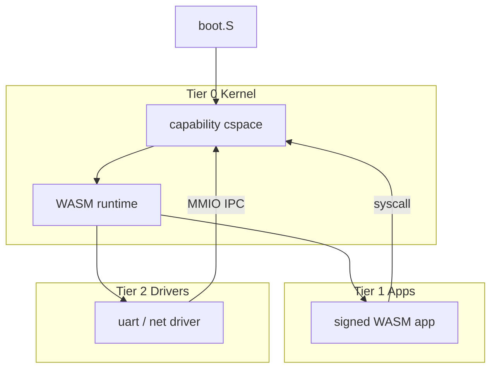

# Arquitectura — wari

## Propósito

Minimal Tier-0 kernel; Tier-1 apps and Tier-2 drivers as signed WASM; boots QEMU and VisionFive 2.

## Mapa de módulos

```
wari/
├── kernel/src/     # cap, mem, mmio, runtime, sched, ipc
├── drivers/        # uart, net (Tier-2 WASM)
├── apps/           # hello, guard (Tier-1)
├── abi-shared/     # Cross-tier ABI types
├── wari-cap, wari-mem, wari-sched, wari-ipc, ...
└── docs/book/      # 6-part architecture book
```

## Diagrama de componentes



## Capas y responsabilidades

Ver [code-walkthrough.md](./code-walkthrough.md) para el recorrido módulo a módulo.

## Documentación adicional

- `docs/architecture.md`
- `docs/invariants.md`
- `docs/book/`
- `docs/STATE-OF-PLAY.md`
