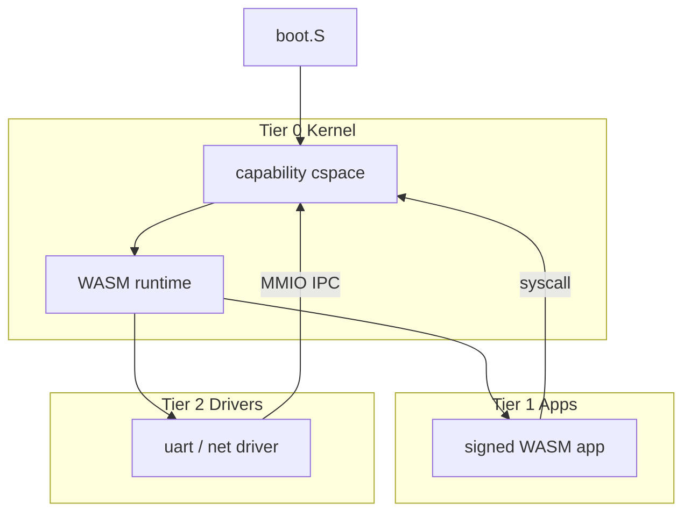
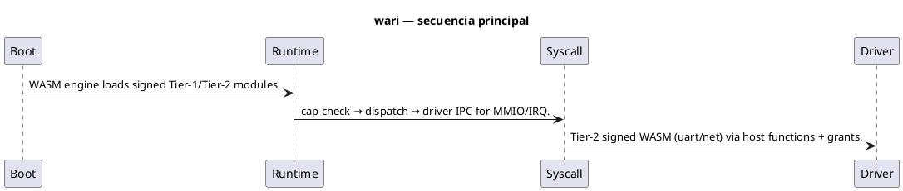
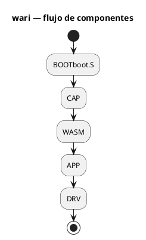

# Flujos — wari

## Flujo principal (Mermaid)

## Descripción paso a paso

1. **Boot** — `boot.S` → `kmain` → paging/traps → capability boot grants.
2. **Runtime** — WASM engine loads signed Tier-1/Tier-2 modules.
3. **Syscall** — cap check → dispatch → driver IPC for MMIO/IRQ.
4. **Driver** — Tier-2 signed WASM (uart/net) via host functions + grants.

## Secuencia (PlantUML)

Fuente: [`diagrams/flow-sequence.puml`](./diagrams/flow-sequence.puml)

## Componentes / estados (PlantUML)

Fuente: [`diagrams/flow-architecture.puml`](./diagrams/flow-architecture.puml)

## Estados y casos borde

Consulta los tests de integración y los RFC/requirements del proyecto para flujos de error y recuperación.
